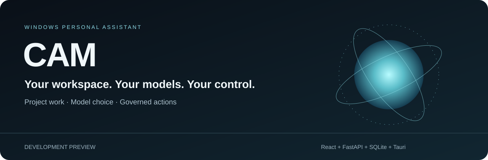
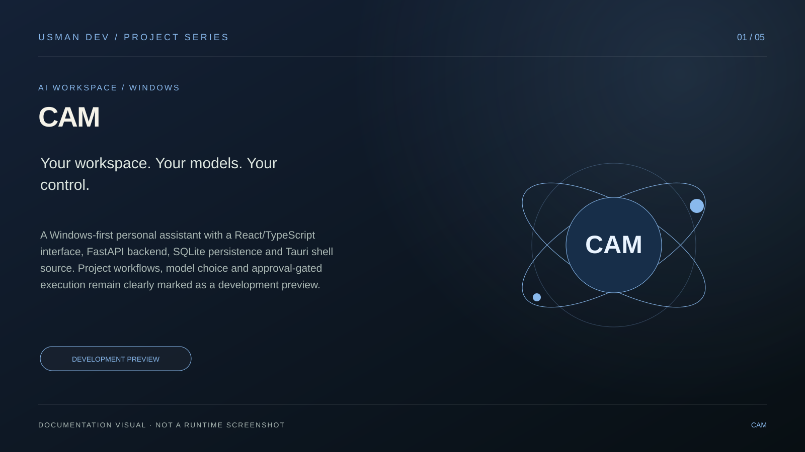
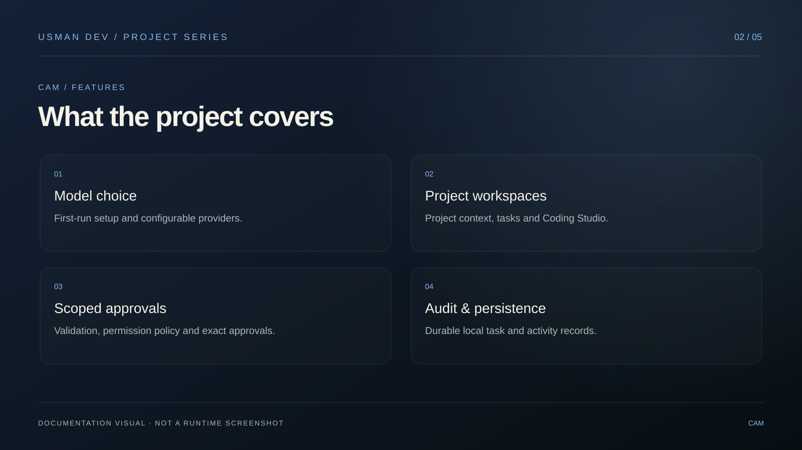
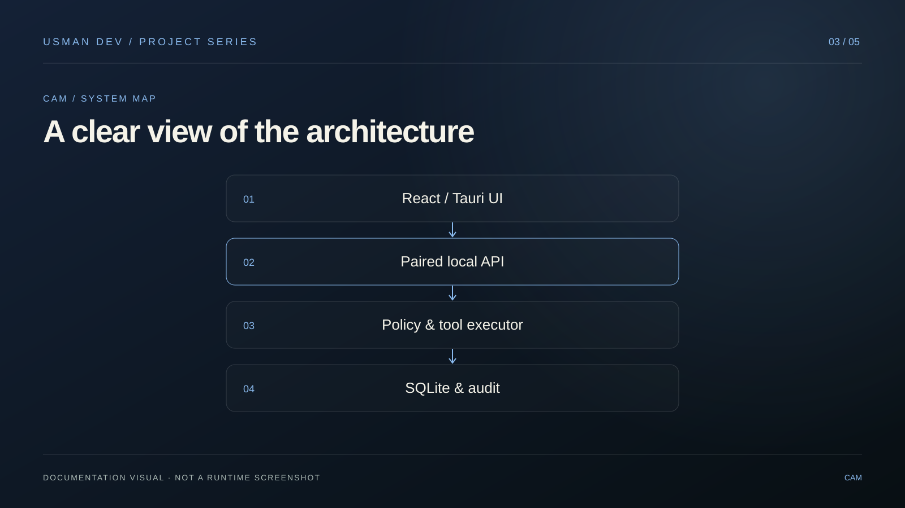
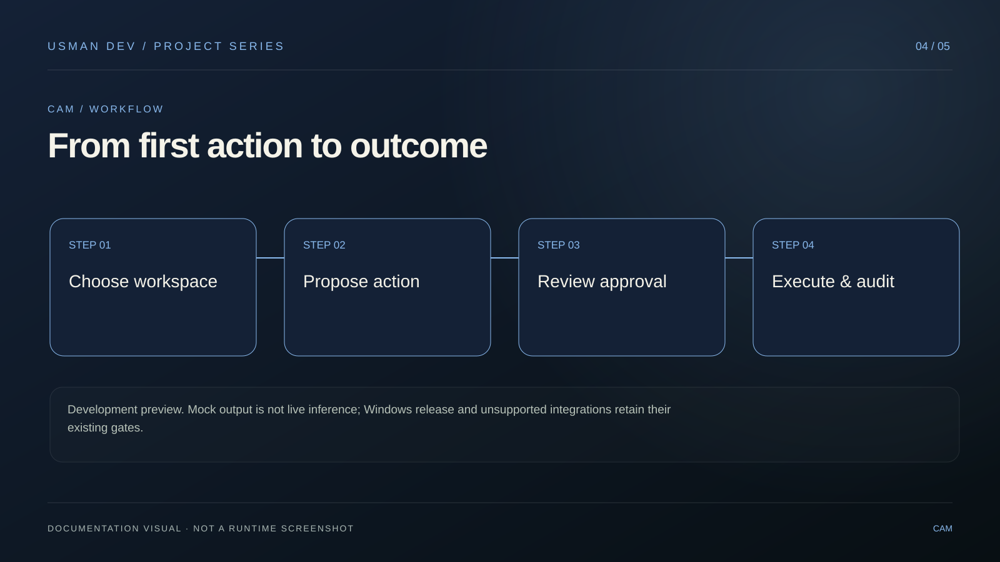
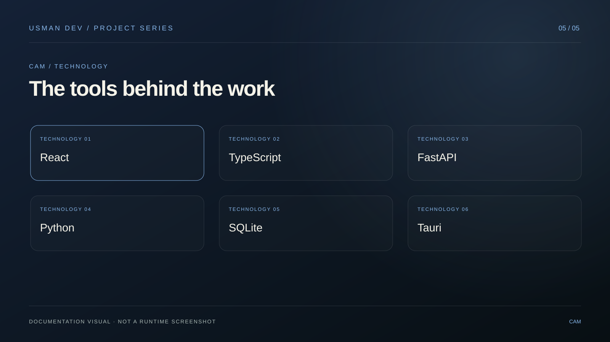
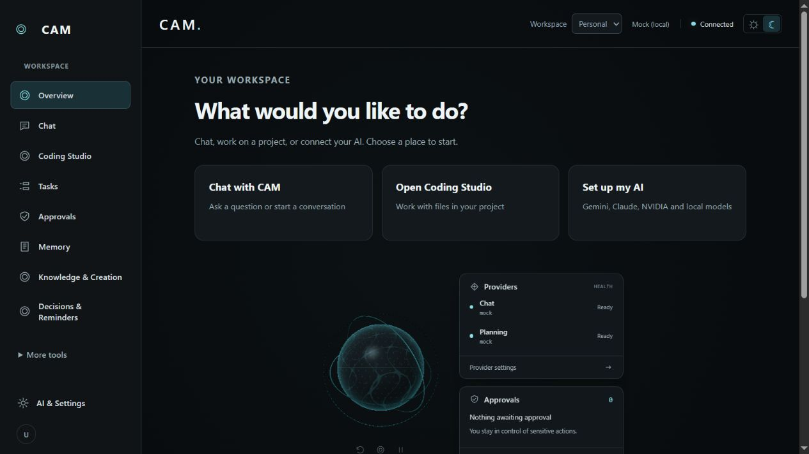
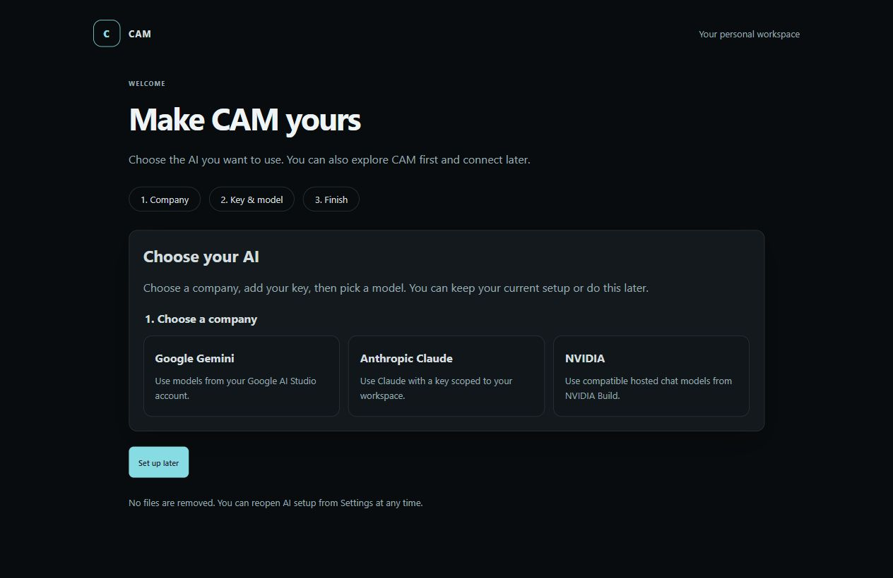
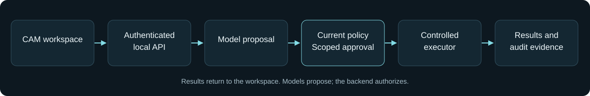

<p align="center">
  
</p>

<p align="center"><strong>A Windows personal assistant for project work, model choice and controlled execution.</strong><br />Development preview · Formerly USMAN JARVIS</p>

<p align="center"><a href="docs/QUICKSTART.md">Get started</a> · <a href="docs/README.md">Documentation</a> · <a href="docs/STATUS.md">Current status</a> · <a href="CONTRIBUTING.md">Contribute</a> · <a href="SECURITY.md">Security</a></p>

---


## Visual project guide

A Windows-first personal assistant with a React/TypeScript interface, FastAPI backend, SQLite persistence and Tauri shell source. Project workflows, model choice and approval-gated execution remain clearly marked as a development preview.

These five original illustrations summarize the documented project. They are **documentation graphics, not application screenshots or evidence of production readiness**.



| Features | Architecture |
| --- | --- |
|  |  |

| Workflow | Technology |
| --- | --- |
|  |  |

**Scope and verification:** Development preview. Mock output is not live inference; Windows release and unsupported integrations retain their existing gates.

[Developer portfolio](https://developer-folio-nov04-ab.glovedlark8.chatgpt.site) (ChatGPT sign-in required) · [Usman Dev](https://github.com/MalikUsmanAbid)

---

## Meet CAM

CAM is a Windows personal assistant built with React, TypeScript, FastAPI, SQLite and a Tauri desktop shell. Formerly USMAN JARVIS.

## Source status

This repository publishes the current implementation, including first-run model setup and ongoing UI work. It is a source snapshot, **not a claim that all roadmap features or Windows release gates are complete**. No newly verified CAM installer is included.

## Main workflows

- Choose Google Gemini, Anthropic Claude or NVIDIA on first launch, enter a key using protected credential storage, and load available models. You can select **Set up later** or keep existing settings.
- Chat, project workspaces, Coding Studio, task approvals, memory and activity views.
- Local Ollama and compatible cloud providers through advanced settings. Mock mode is deterministic development output, not AI inference.
- Execution remains controlled by permission policy, exact approvals and audit records. Provider setup does not enable paid usage: cloud consent, pricing and positive limits are separate requirements.

Existing internal package identifiers and `%LOCALAPPDATA%/USMANJARVIS` data paths are retained for upgrade compatibility. This source folder does not contain your existing database or settings.

## Take a look



*Actual React UI with disposable fixture responses. Mock mode is shown; no live AI inference or personal data is represented.*

<details>
<summary><strong>First launch: choose your AI or set it up later</strong></summary>



*Actual UI with a simulated desktop bridge for documentation. No API key was entered. This is not packaged Windows or provider acceptance evidence.*

</details>

[Screenshot provenance →](docs/SCREENSHOTS.md)

## What is in the source

| Area | Implementation | Verification boundary |
| --- | --- | --- |
| Model setup | Gemini, Claude and NVIDIA; protected key references; skip and keep-settings paths | Live inference needs your key, consent and acceptance checks |
| Project work | Project registry, context workflows and Coding Studio source | Use fixture projects first; review proposed changes and commands |
| Governed execution | Scope validation, current policy, exact approvals and audit | Approvals do not replace platform isolation |
| Windows shell | Tauri shell, backend ownership and packaging source | Fresh CAM installer/portable acceptance is pending |
| Automation and accounts | Browser, UI automation and connector implementation paths | Unsupported or unverified execution must remain disabled |

## How execution flows



The backend authorizes actions. Models, repository instructions, retrieved documents and MCP results cannot grant permissions.

## Development

Prerequisites: Python 3.12+, Node.js 20+. Windows desktop packaging additionally requires Rust and the documented Windows toolchain.

```powershell
py -m venv .venv
.\.venv\Scripts\python.exe -m pip install -e ".[dev]"
Copy-Item .env.example .env # only if .env does not already exist
.\.venv\Scripts\python.exe -m uvicorn services.agent_api.app.main:app --host 127.0.0.1 --port 8000
```

In a second terminal:

```powershell
cd apps\desktop
npm ci
npm run dev
```

Open `http://127.0.0.1:5173` and pair using the current backend pairing code. The API must remain on loopback. Existing database migrations require explicit authorization and a consistent backup; see [foundation instructions](docs/M1_FOUNDATION.md). Do not start development against personal persistence when running tests.

## Verification

```powershell
py -m pytest -q
py -m ruff check services tests
cd apps\desktop
npm test -- --pool=forks --maxWorkers=1 --testTimeout=30000
npm run lint
npm run build
```

See [publication notes](PUBLISHING.md), [Windows packaging](docs/WINDOWS_RELEASE_QUICKSTART.md), [model setup guide](docs/CLOUD_MODEL_SETUP_ROMAN_URDU.md) and [architecture](docs/ARCHITECTURE.md). Historical documentation describes earlier releases and may retain former branding.

## Security and limitations

Never commit API keys, `.env`, databases, personal workspaces, build caches or credential files. This snapshot excludes those locations and previous local Git history. Model lists and mocked provider tests do not prove live inference. Live cloud usage needs your credentials and consent; browser isolation, Windows automation and release acceptance require their documented platform verification. Unsupported execution must remain disabled.

CAM is licensed under the [MIT License](LICENSE). Third-party dependencies retain their respective licenses.

## Help and contributions

Read [CONTRIBUTING.md](CONTRIBUTING.md) before opening a pull request, use [SUPPORT.md](SUPPORT.md) for ordinary bugs, and report vulnerabilities through the private route described in [SECURITY.md](SECURITY.md). Never upload credentials or personal persistence.

Maintained by [MalikUsmanAbid](https://github.com/MalikUsmanAbid). The banner is original CAM artwork. Third-party dependencies retain their respective licenses. See the [public-source checklist](docs/PUBLIC_RELEASE_CHECKLIST.md) for visibility, license and release gates.

Developer contact: [usman234dev@gmail.com](mailto:usman234dev@gmail.com). Project source is released under the [MIT License](LICENSE).
